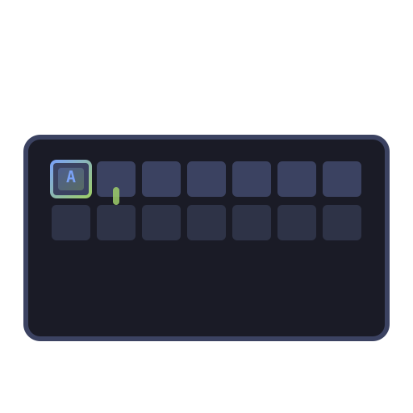

<div align="center">

# ⌨️ Typing Academy

**A touch-typing tutor for the Omarchy bar — guided lessons, adaptive drills, clean
speed tests, live keyboard map, games and long-term progress tracking. Everything
is local.**



[](https://omarchy.org)
[](#license)
[](https://www.qt.io)
[](#-overview)

</div>

---

## 📦 Installation

```sh
omarchy plugin install nishant/typing-academy
```

Then reload the shell:

```sh
omarchy restart shell
```

---

## 🎯 Overview

Typing Academy is an **Omarchy shell plugin** that turns your desktop into a complete
typing-education environment. It opens an app-style overlay window from the
Omarchy bar widget, with a full curriculum, drills, speed tests, a live keyboard
map, games and progress tracking — all running locally.

---

## ✨ Features

### 📚 Learn — guided curriculum
34 lessons across 8 stages (home row → top row → bottom row → capitals →
punctuation → numbers → words → sentences). Lessons unlock in order; finished
lessons stay open for star chasing.

### 🔥 Drills — adaptive practice
- Word, capital, punctuation and number drills
- **Structural drills**: alternating hands, same-hand rolls, common trigrams
- **Six text packs** from real-world material
- Custom-text drill
- Weak-key chips from *your* slowest keys and pairs

### ⚡ Speed test — clean measurement
- Timed (15 / 30 / 60 / 120 s)
- Word-count modes (10 / 25 / 50 / 100)
- Quote mode
- **Code mode** — untimed, ends at last character, per-language snippets

### ⌨️ Keyboard — live map
Full US QWERTY map coloured by finger, per-key speed and accuracy, one-click key drills.

### 🎮 Games — skill games that feed stats
- **Falling words** — words drop, type to clear, 3 misses end the run
- **Word sprint** — one word at a time, 45 s, as many as you can
- **Key hunt** — a letter appears, find it without looking down, escalates
- **Speed burst** — one letter at a time, 15 s, as fast as you can
- **Accuracy gauntlet** — endless words, one wrong key ends the run, no clock
- **Pattern mirror** — sequence memory, type it back, each round adds one letter

### 📈 Progress — motivation that sticks
Level and XP, personal bests, streaks, practice calendar, speed-over-time chart,
achievements.

### ⚙️ Settings — full control
Sound and volume, live stats, caret, text size, keyboard visibility, strict mode,
default test mode, punctuation/numbers defaults.

---

## 🚀 Quick start

```sh
# Open / close the widget
omarchy-shell shell toggle nishant.typing-academy

# Open on a specific tab
omarchy-shell shell summon nishant.typing-academy '{"tab":"drills"}'
```

The widget lives in your Omarchy bar. Click it to open the overlay window
(sits below the bar, bar stays visible). Click **Full screen** in the corner to
expand it like a real app.

---

## ⌨️ Controls

| Keys | Action |
| --- | --- |
| `ctrl+1` … `ctrl+7` | Jump to a tab |
| `ctrl+tab` | Cycle tabs |
| `enter` | Start the obvious thing on the current tab |
| `esc` | Leave practice / game, or close the academy |
| `f11` | Toggle full screen |

---

## 🧰 Development

```sh
omarchy plugin validate .
journalctl --user -t omarchy-shell   # watch QML warnings
```

---

## 📄 License

MIT

---

<div align="center">
  
</div>
